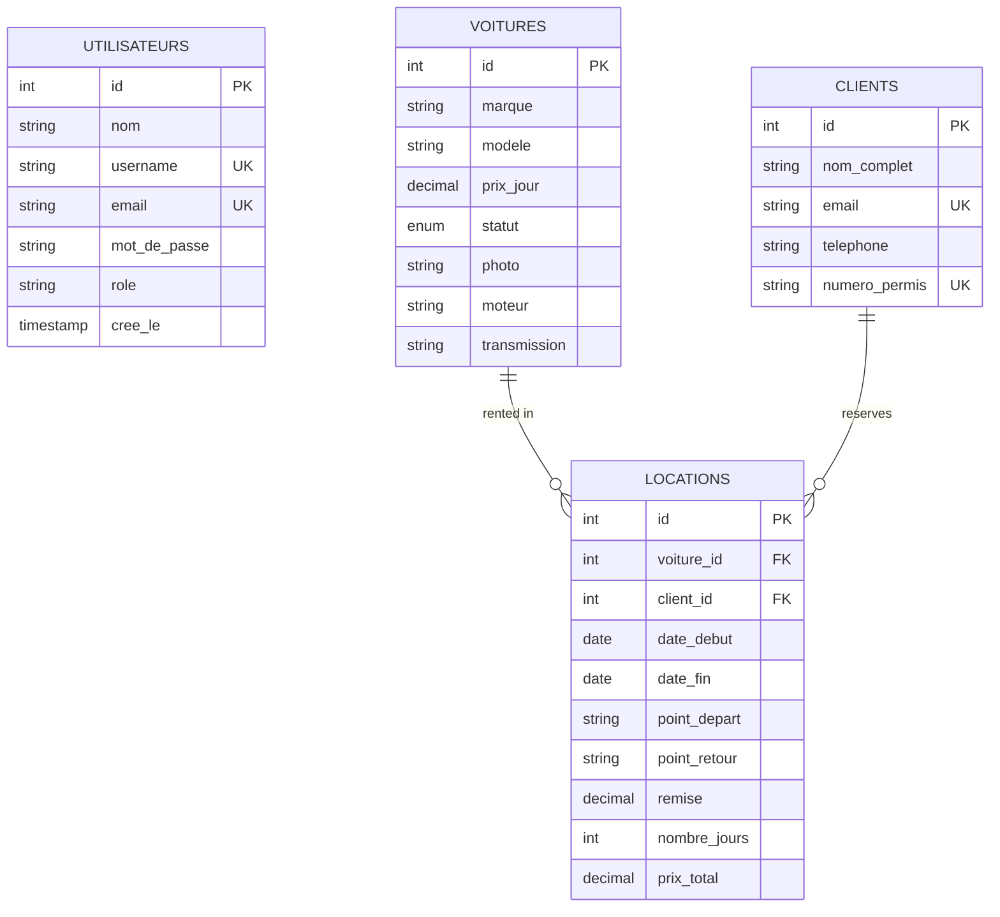

# 🚗 Location de Voitures — Car Rental & Fleet Management Platform


A full-stack, enterprise-grade **Car Rental and Fleet Management System** built with **Java 21**, **Spring Boot 3.3.5**, and **JSF / PrimeFaces**, backed by **MySQL**, and verified with automated **Playwright E2E tests**.

This platform provides end-to-end management of vehicle inventory, customer profiles, booking calculations, and secure role-based administrative workflows.

---

## 🏗️ Technologies Used

### Backend & Core Framework
* **Java 21 (LTS):** Modern object-oriented backend logic.
* **Spring Boot 3.3.5:** Core application framework, dependency injection, and configuration.
* **Spring Security:** Authentication, BCrypt password encryption, session management, and role-based access control (`ROLE_ADMIN`, `ROLE_CLIENT`).
* **Spring JDBC (`spring-boot-starter-jdbc`):** High-performance, lightweight database connectivity and SQL repository queries.
* **Spring Mail (`spring-boot-starter-mail`):** Automated email notifications and verification codes.

### Frontend & User Interface
* **Jakarta Server Faces (JSF 4) & PrimeFaces:** Via **JoinFaces 5.3.4** integration, providing rich server-side UI components (`DataTable`, `Dialog`, `SelectOneMenu`, calendars).
* **Responsive HTML5 / CSS3 / JavaScript:** Modern, responsive login and client registration interfaces.

### Database
* **MySQL:** Relational database storage managing vehicles, customers, user accounts, and rental records with foreign key constraints.

### Quality Assurance & Automated Testing
* **Playwright (Node.js / JavaScript):** Automated End-to-End (E2E) browser test suite in [`e2e-tests/`](e2e-tests/) verifying authentication, UI components, and rental dashboards.
* **JUnit / Spring Boot Test:** Backend unit and integration testing.

---

## 🌟 Key Features Implemented

### 1. 🔐 Authentication & Role-Based Security
* **User Registration & Login:** Custom Spring Security authentication with BCrypt password hashing.
* **Automatic Admin Bootstrap:** Automatically seeds an administrator account upon startup via `InitialiserAdmin.java`.
* **Session Protection:** Route protection ensuring dashboard access requires valid authentication.

### 2. 🚘 Vehicle & Fleet Management (`Voitures`)
* **Vehicle Inventory:** Manage car brand, model, engine type, transmission (Manual/Automatic), and daily rental rate.
* **Status Lifecycle Tracking:** Dynamic vehicle status tracking:
  * `DISPONIBLE` (Available)
  * `OCCUPE` (Currently Rented)
  * `EN_PANNE` (Out of Order)
  * `MAINTENANCE` (In Service)
* **Photo Uploads & Visual Badges:** Upload and display vehicle imagery.

### 3. 👥 Customer Management (`Clients`)
* Customer records capturing Full Name, Email, Phone Number, and unique Driving License Number (`numero_permis`).
* Email and driver's license uniqueness validation.

### 4. 📅 Rental & Booking Engine (`Locations`)
* **Duration & Rate Calculation:** Automatically computes total days (`nombre_jours`) and total price (`prix_total = (prix_jour * jours) - remise`).
* **Pickup & Return Logistics:** Specify departure and return locations (`point_depart`, `point_retour`).
* **Discount Handling:** Ability to apply promotional discounts (`remise`).

### 5. 🧪 Automated E2E Testing with Playwright
* Complete test suite under [`e2e-tests/tests/app.spec.js`](e2e-tests/tests/app.spec.js).
* Automates:
  * Login page rendering and title validation.
  * Successful authentication with dashboard redirect.
  * PrimeFaces interactive UI controls (`ui-selectonemenu`) manipulation.

---

## 🗄️ Database Architecture & Schema

The application uses a normalized MySQL database structure:



---

## 📂 Project Structure

```text
location-voitures/
├── pom.xml                                      # Maven dependencies & build configuration
├── sql/
│   └── schema.sql                               # MySQL database schema definition
├── src/
│   ├── Main/
│   │   ├── java/com/locationvoitures/
│   │   │   ├── LocationVoituresApplication.java # Spring Boot entry point
│   │   │   ├── config/SecurityConfig.java       # Spring Security & BCrypt config
│   │   │   ├── controller/                      # Web controllers (Registration, etc.)
│   │   │   ├── modele/                          # Entities (Client, Voiture, Location)
│   │   │   ├── repository/                      # JDBC Data Repositories
│   │   │   ├── service/                         # Business services & admin bootstrap
│   │   │   └── vue/LocationView.java            # PrimeFaces / JSF Managed Bean
│   │   ├── resources/
│   │   │   └── application.properties           # Database & server configuration
│   │   └── Webapp/
│   │       ├── index.xhtml                      # Main PrimeFaces rental management dashboard
│   │       ├── login.html                       # Responsive login portal
│   │       └── registration.html                # Client registration form
│   └── test/java/                               # Backend unit & integration test suites
└── e2e-tests/
    ├── package.json                             # Playwright dependencies
    ├── playwright.config.js                     # Playwright test configuration
    └── tests/
        └── app.spec.js                          # Automated E2E test specs
```

---

## 🚀 Getting Started

### Prerequisites
* **Java Development Kit (JDK 21+)** installed.
* **Apache Maven 3.9+** installed.
* **MySQL Server 8.0+** running locally.
* **Node.js (v18+)** *(optional, for running Playwright tests)*.

### 1. Database Setup
1. Open your MySQL client and execute the schema:
   ```sql
   source sql/schema.sql;
   ```
2. Update database credentials in [`src/Main/resources/application.properties`](src/Main/resources/application.properties):
   ```properties
   spring.datasource.url=jdbc:mysql://localhost:3306/location_voitures
   spring.datasource.username=root
   spring.datasource.password=YOUR_PASSWORD
   ```

### 2. Build and Run the Web Application
```bash
# Build the application
mvn clean package

# Run with Spring Boot
mvn spring-boot:run
```
Once started, access the application in your browser:
* **Login URL:** `http://localhost:8080/location-voitures/login.html`
* **Dashboard URL:** `http://localhost:8080/location-voitures/`
* **Default Admin Credentials:** Seeded automatically on startup (`admin` / `triztech123`).

### 3. Run Automated E2E Tests (Playwright)
```bash
cd e2e-tests
npm install
npx playwright test
```
To view the visual test report:
```bash
npx playwright show-report
```

---

## 👤 Author

* **Developer & QA:** Samir Boussada
* **GitHub:** [@samir-boussada](https://github.com/samir-boussada)
* **Repository:** [location-voitures](https://github.com/samir-boussada/location-voitures)
